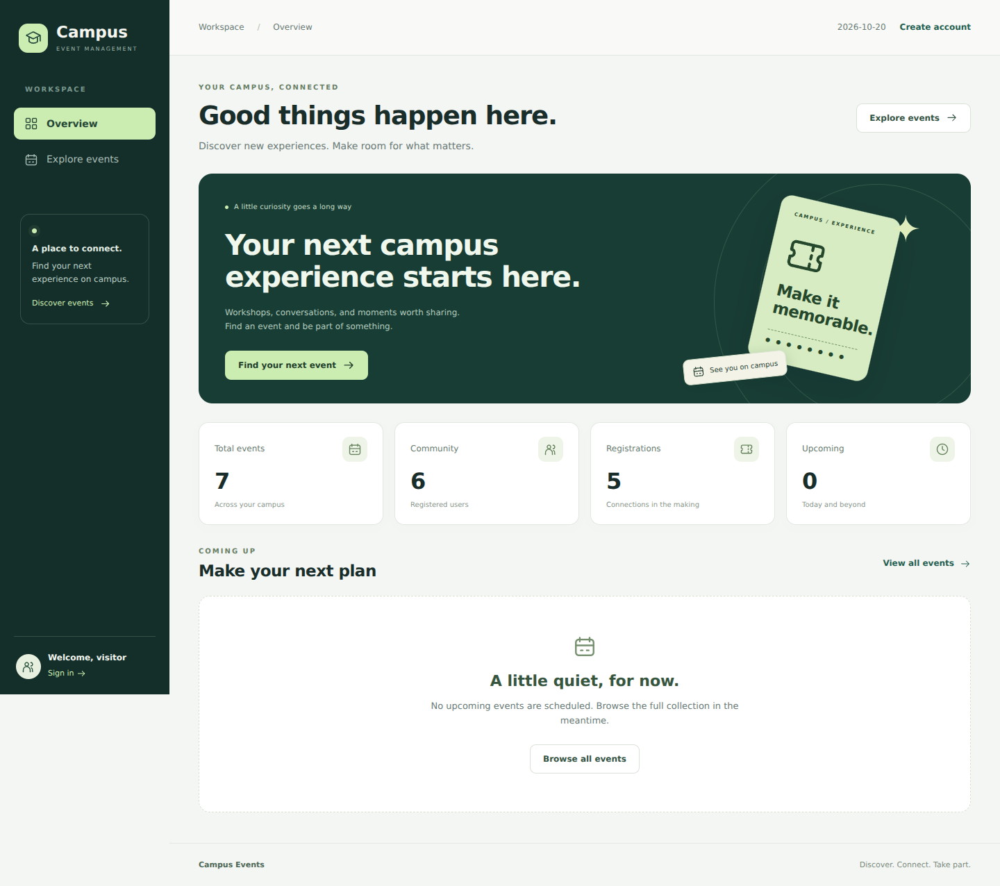
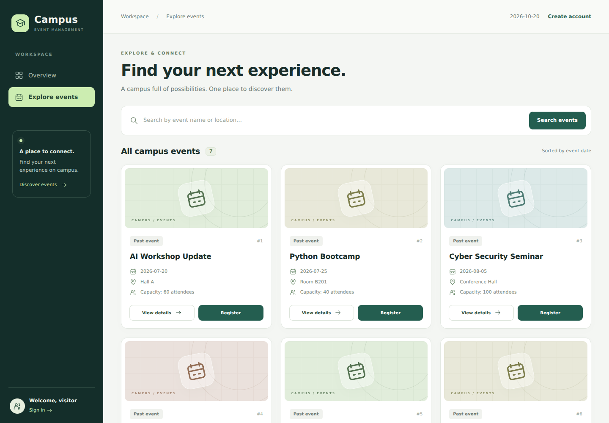
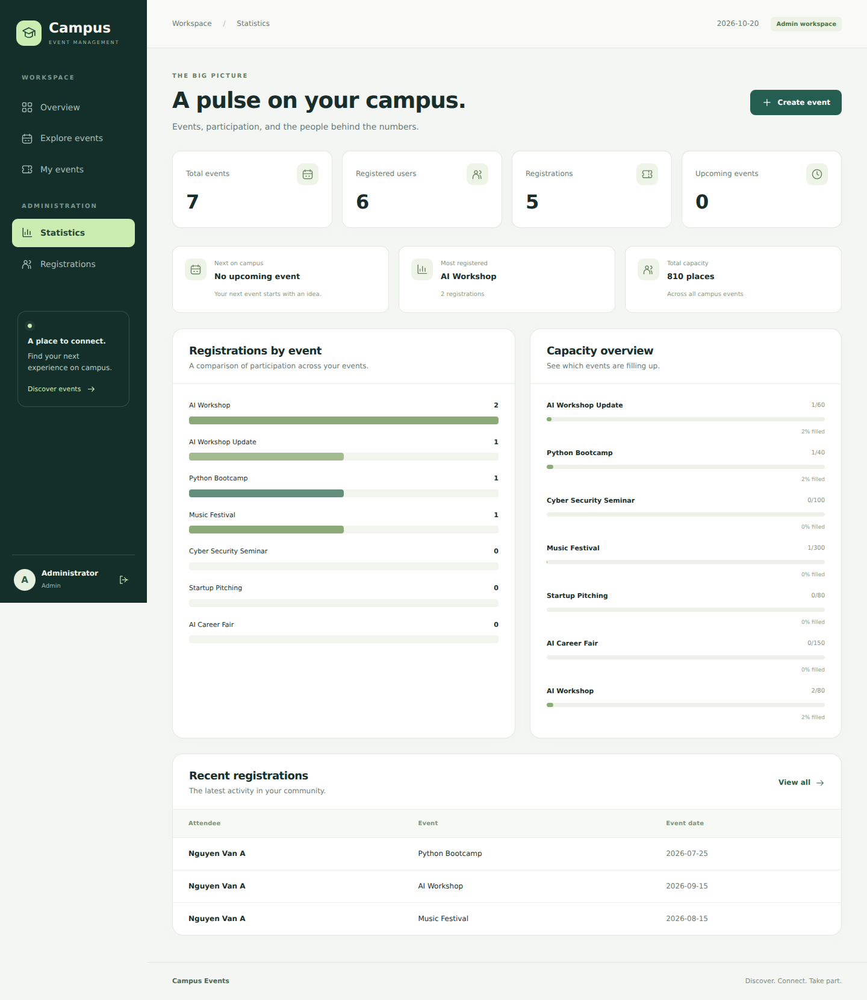
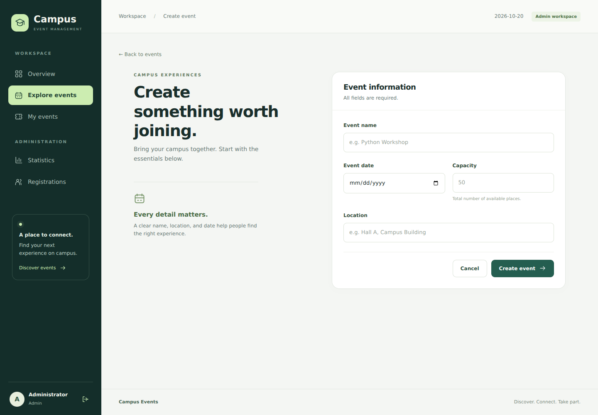
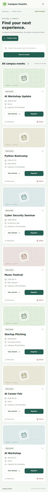

# 📅 Campus Event Management

A Python and Flask coursework application for browsing campus events,
managing student registrations, and administering events through a
responsive web interface.

**Technologies:** Python · Flask · SQLite · HTML · CSS · JavaScript

🌐 [Open live demo](https://campus-event-management-web.onrender.com)

The demo may take about a minute to load after inactivity.

## Overview

This project brings campus event information and registrations into
one application.

Students can explore events and manage their registrations.
Administrators can manage events and review participation statistics.

This repository contains the web version. The separate console
application is available in
[Campus-Event-Management](https://github.com/LinhNHG/Campus-Event-Management).

## Screenshots

### Application Overview



### Event Catalogue



### Administrator Dashboard



<details>
<summary>More screenshots: event form and mobile interface</summary>

### Event Form



### Mobile Interface



</details>

## Features

### Students

- Browse events and view event details.
- Search events by name or location.
- Check registration availability.
- Register for events and cancel registrations.
- View personal registrations.

### Administrators

- Create, edit, and delete events.
- Review registrations.
- View participation statistics and capacity comparisons.

### Interface and Registration Checks

- Responsive layouts for desktop and mobile.
- Duplicate-registration and event-capacity checks.
- Confirmation prompts for selected actions.
- Accessible form labels and visible keyboard focus.
- Local CSS, JavaScript, and SVG icons.

## Technology Stack

| Technology | Purpose |
|---|---|
| Python and Flask | Application routes and server-side logic |
| SQLite | Event, user, and registration storage |
| Jinja | Server-rendered HTML templates |
| HTML and CSS | Page structure and responsive styling |
| JavaScript | Mobile navigation and confirmation prompts |
| Render | Hosting for the linked demo |

## Run Locally

Requires Python 3.10 or newer and Git.

### Windows

```powershell
git clone https://github.com/LinhNHG/Campus-Event-Management-Web.git
cd Campus-Event-Management-Web
py -m venv .venv
.venv\Scripts\python.exe -m pip install -r requirements.txt
.venv\Scripts\python.exe app.py
```

Open http://127.0.0.1:5000 in your browser.
Stop the server with `Ctrl+C`.

A sample `database.db` is included.

If the database is missing, initialize it before starting the app:

```powershell
.venv\Scripts\python.exe init_db.py
```

The initializer stops if the database already exists;
it does not reset existing data.

### macOS / Linux

```bash
git clone https://github.com/LinhNHG/Campus-Event-Management-Web.git
cd Campus-Event-Management-Web
python3 -m venv .venv
.venv/bin/python -m pip install -r requirements.txt
.venv/bin/python app.py
```

If the database is missing, initialize it before starting the app:

```bash
.venv/bin/python init_db.py
```

## Demo Accounts and Authentication

The classroom sign-in flow uses a **User ID only**.

| User ID | Role |
|---|---|
| `admin` | Administrator |
| `student1` | Student |
| `student2` | Student |

A student account can also be created through **Create account**.

**This is an educational demonstration.** Password authentication
is not implemented. Knowing a demo User ID allows access as that user,
so the application should not be used for real accounts or private data.

## Project Structure

```text
Campus-Event-Management-Web/
├── app.py                 # Flask routes and session flow
├── database.py            # SQLite queries
├── database.db            # Sample database
├── schema.sql             # Database schema
├── init_db.py             # First-time database initialization
├── requirements.txt       # Python dependencies
├── docs/                  # Interface screenshots
├── templates/             # Jinja templates
└── static/
    ├── css/style.css      # Responsive styles
    └── js/app.js          # Navigation and confirmation prompts
```

## Future Improvements

- Add password authentication with secure password hashing.
- Add automated tests for registration and permission checks.
- Improve deployment configuration for use beyond a classroom demo.

## Project Context

Developed as a Python coursework project to practice web development,
relational data storage, and event-registration workflows.
